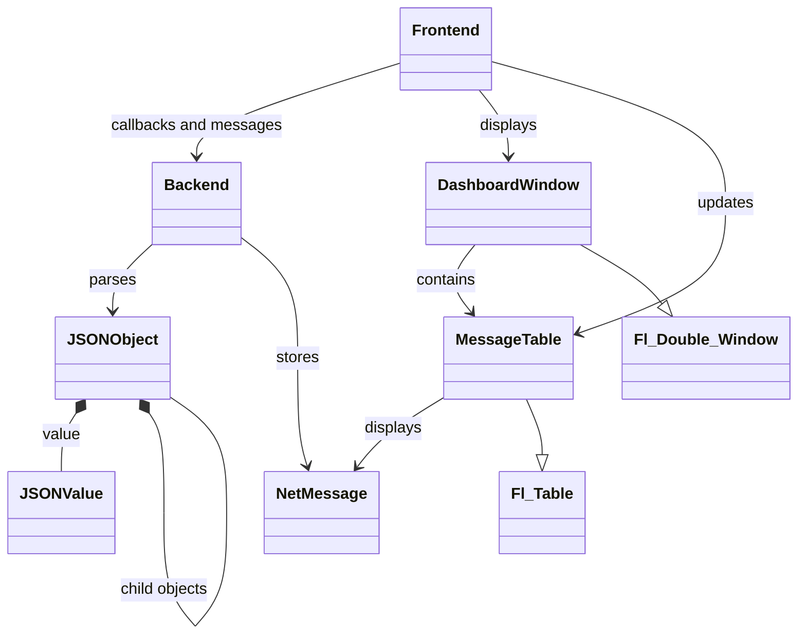

# Observability Dashboard - Coding Assignment

This c++ app displays messages received in a specific JSON format POSTed on localhost on the 8080 port.

## Assumptions

- This app will run locally for demonstration purposes.
- This app does not need to act as a large-scale server that will handle very large or numerous requests at the same time.

## REQs

- Dashboard should be in its own window that can be resized to show more lines and give more space to the columns.
- Dashboard should be able to receive and parse messages received in POST requests as dezscribed in the ICD section of this document.
- Dashboard should display table with 3 columns "Timestamp" (human readable), "App" and "Message".
- Dashboard should display most recent messages at the top.
- Dashboard should log the received messages in a csv log file with the format timestamp(epoch),app,message.
- Dashboard should have a "Clear" button to flush the displayed messages. This does not affect the logs.

## ICD

The dashboard will messages in POST request with the following payload format.

The message format is the following :

```txt
{
    "timestamp":"<epoch_time>",
    "app":"<application_name>",
    "message":"<message_content>"
}
```

For example :

```txt
{
    "timestamp":"1755544291",
    "app":"EXAMPLE_APP",
    "message":"Example app started successfully"
}
```

The dashboard will reply with a body-less 200 for success, or 400 for bad request (either badly formed POST requests, or non-POST requests)
It is expected that the both the dashboard and the sender are run locally.

## Design

Since the scope is very limited for this task the design will be as simple as possible with a "Backend" and a "Frontend" class containing some subclasses as needed. This diagram shows each class used and how they interact.



### Backend

The backend class will handle the post requests, parse the JSON received and log the received messages.
It will hold a "latest message" std::dequeue with the received messages until they are cleared.
It will have a callback to tell the Frontend to update it's table data when new messages are received.

The subclasses are NetMessage to hold messages and format the timestamp, and JSON to parse JSONs and access JSON objects.

### Frontend

The frontend will handle the drawing of the table whenever a new message is received through an "update()" callback.
It will also hold a callback to the backend for the "Clear" button press.
Most of the Frontend code is setting up and drawing the table, resizing the columns/rows/scrollbars.

The subclasses are MessageTable to handle the table writing and drawing, and DashboardWindow to handle the window hosting the table and the button.

The Frontend uses FLTK as it's lightweight but has the few widgets I need, and allows direct callbacks on buttons.

### JSON

The JSON lib is a recursive JSON object parser that tries to parse as much as possible and works with the JSON standart. It works by parsing the JSON linearly. When it detects a boundary ({, [ or ") it finds the end and recurses on that object as needed. All the recursive JSONObjects are deleted with their parent.

## Build

An internet connection is required to fetch FLTK on the first configure.

To build :

```sh
cmake -S . -B build
cmake --build build
```

Run the executable from the build directory:

```sh
./build/Debug/ObservabilityDashboard.exe
```

## Usage

When running the Dashboard, the logging happens in a CSV file right next to the executable. There is also a debug log included.

For testing, the easiest method is to send a JSON through curl.exe. For a Windows command prompt, use this :

```sh
curl.exe -X POST http://localhost:8080 -H "Content-Type: application/json" --data-raw "{\"timestamp\":\"1755544291\",\"app\":\"EXAMPLE_APP\",\"message\":\"Example app started successfully\"}"
```

Using -d instead of "--data-raw" strips the double quotes from the JSON and causes issues with the parsing.

I also added a quick test script in the root folder called testingScript.cmd that can be run in command box to send some requests (valid and invalid)
